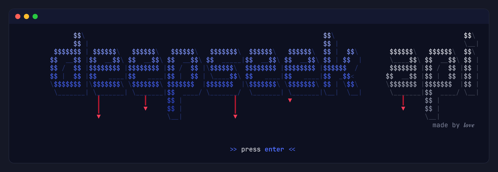
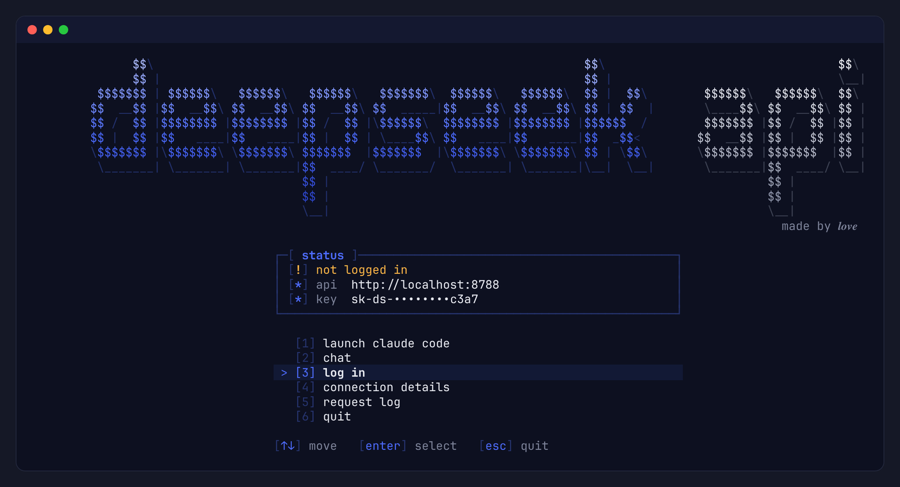

# DeepSeek Free API

Use DeepSeek for free from your terminal. It logs in with your chat.deepseek.com account and gives you a local **OpenAI** and **Anthropic** compatible API, so Claude Code, scripts and other tools can run on DeepSeek.



> Unofficial. It uses DeepSeek's private web API, which can change or block you at any time and probably breaks their terms. Personal use only.

## Install

Needs Node 18+. No npm dependencies.

```sh
git clone https://github.com/loveranmar/deepseek-free-api
cd deepseek-free-api
npm link            # or: ln -s "$PWD/bin/deepseek.js" ~/.local/bin/deepseek
deepseek
```



## Log in

Pick **log in** in the app (or run `deepseek login`):

1. chat.deepseek.com opens in your browser. Log in as usual.
2. Open the console (`F12`, or `Cmd+Option+J` on macOS).
3. Paste the line the app put on your clipboard and press Enter. If pasting is blocked, type `allow pasting` first.

The app picks up the token from the clipboard on its own. Only the token is saved, in `data/config.json`.

## Commands

```
deepseek                 open the app
deepseek claude [args]   launch Claude Code on DeepSeek
deepseek chat            chat in the terminal
deepseek login           log in (or --token <t>)
deepseek logout          forget the session
deepseek status          is the session alive?
deepseek serve           API only, with a request log
--port <n>               API port (default 8788)
```

## Use the API

The API key and URL are under **connection details** in the app.

```sh
# Claude Code (or just: deepseek claude)
ANTHROPIC_BASE_URL=http://localhost:8788 ANTHROPIC_AUTH_TOKEN=<key> claude
```

```python
from openai import OpenAI
client = OpenAI(base_url="http://localhost:8788/v1", api_key="<key>")
```

Models: `deepseek-chat`, `deepseek-reasoner`, `deepseek-chat-search`, `deepseek-reasoner-search`. Any other model name falls back to `deepseek-chat`.

## Limits

- Tool calling is emulated through the prompt, so it's only as reliable as the model's formatting.
- No image input. Token counts are estimates.
- DeepSeek can revoke your token at any time. If that happens, log in again.

## Credits

Protocol and PoW approach adapted from [ForgetMeAI/FreeDeepseekAPI](https://github.com/ForgetMeAI/FreeDeepseekAPI) (MIT), checked against [NIyueeE/ds-free-api](https://github.com/NIyueeE/ds-free-api) and [iidamie/deepseek2api](https://github.com/iidamie/deepseek2api).

MIT license.
